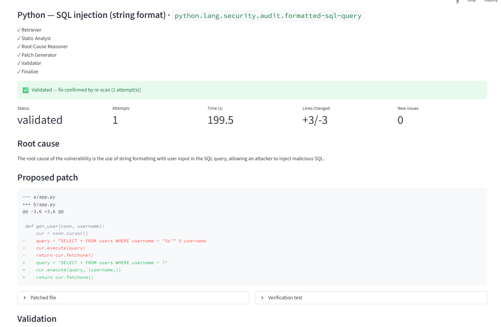

# VulnFix: local AI agents that fix code vulnerabilities and check their own work

[](https://github.com/BinuShefieldShifani/vulnfix/actions/workflows/ci.yml)

VulnFix takes a finding from a security scanner (a SARIF file from Semgrep, CodeQL or Bandit), works out why the code is vulnerable, writes a patch, and re-scans the patched code to check it. Everything runs on your own machine with LangGraph, ChromaDB and Ollama. No code leaves the box, so it can run air-gapped.



## How it works

```
SAST/DAST report ──▶ secure parsing ──▶ local embeddings ──▶ private Chroma DB
                                                                      │
        ┌──────────────────────────────────────────────────────────── ┘
        ▼
   Retriever ─▶ Static Analyst ─▶ Root-Cause ─▶ Patch Generator ─▶ Validator
                                                      ▲                │
                                                      └── retry if failed ┘
                                                                       │
                                            Structured JSON + patch + test
                                                                       │
                                              Streamlit UI  /  REST API (CI/CD)
```

1. **Retriever** pulls related OSV advisories (CWE, CVSS, fixed versions) from a local Chroma collection.
2. **Static Analyst** reads the flagged code and the finding.
3. **Root-Cause Reasoner** explains in plain words why the code is exploitable.
4. **Patch Generator** writes a fix as a unified diff.
5. **Validator** scans the original and the patched code with Semgrep (custom VulnFix rules plus `p/default`) and Bandit, then compiles the patch (`compile()` for Python, `javac` for Java). The patch passes only if every scanner hit related to the finding's CWE is gone, nothing new appeared, and the code compiles. If it fails, the reason (including the compiler's error message) goes back to the Patch Generator for another attempt.

Models: `qwen2.5-coder:7b` for patches, `llama3.1:8b` for reasoning, `nomic-embed-text` for embeddings. Every model call uses a mild repeat penalty and an output cap, and retries with a slightly higher temperature if Ollama aborts a repeat loop or the reply has no usable JSON.

## Results

The same 10 vulnerable cases, plus 1 negative control (code that is already safe), have been through four runs so far. Each run taught me more about the validator than about the model.

| | Run 1 (June) | Run 3 | Run 4 |
|---|---|---|---|
| Exploitable patch marked "validated" | 3 | 0 | 0 |
| Non-compiling patch marked "validated" | 0 | 1 | 0 |
| Real fixes (after manual review) | 7 | 3 | 6 |
| Model errors | 0 | 2 | 0 |

### Run 1 (June): 10 "validated", 3 still exploitable

The Validator marked all 10 as fixed on the first attempt. Then I reviewed every patch by hand.

| Finding | Language | Validator | Manual review | Time |
|---|---|---|---|---|
| [SQL injection (string format)](screenshots/python-sqli.png) | Python | ✅ validated | ✅ Fixed: parameterized query | 199.5 s |
| [SQL injection (Statement concat)](screenshots/java-sqli.png) | Java | ✅ validated | ✅ Fixed: PreparedStatement | 200.5 s |
| [Command injection (Runtime.exec)](screenshots/java-command-injection.png) | Java | ✅ validated | ✅ Fixed: ProcessBuilder with argument list | 187.4 s |
| [Insecure YAML load](screenshots/python-yaml-load.png) | Python | ✅ validated | ✅ Fixed: `yaml.safe_load` | 132.2 s |
| [Weak password hash (MD5)](screenshots/python-md5-password.png) | Python | ✅ validated | ✅ Fixed: bcrypt (old hashes need migrating) | 159.6 s |
| [Hardcoded credentials](screenshots/python-hardcoded-credentials.png) | Python | ✅ validated | ✅ Fixed: token read from environment | 181.2 s |
| [Unsafe deserialization (pickle)](screenshots/python-pickle.png) | Python | ✅ validated | ✅ Fixed: JSON instead (changes behavior) | 172.0 s |
| [OS command injection](screenshots/python-os-command-injection.png) | Python | ✅ validated | ❌ Still injectable | 141.8 s |
| [Path traversal](screenshots/python-path-traversal.png) | Python | ✅ validated | ❌ Still traversable | 181.2 s |
| [Code injection (eval)](screenshots/python-eval.png) | Python | ✅ validated | ❌ Still runs attacker code | 187.7 s |

**Why three bad patches passed.** The Validator checked that the Semgrep rule stopped firing, not that the attack stopped working. In all three cases the model changed the code just enough to stop matching the rule's pattern.

- **OS command injection.** `"ping -c 1 " + host` became `f'ping -c 1 {host}'`. Same shell, same string, same bug: `host = "8.8.8.8; rm -rf /"` still works. The Java patch for the same bug got it right with `ProcessBuilder`.
- **Path traversal.** `Path('/var/data/') / filename` doesn't stop `../../etc/passwd`. Worse, if `filename` is absolute, like `/etc/passwd`, pathlib throws away the base folder entirely.
- **Code injection (eval).** The patch parses the input with `ast` but only checks the top-level node. `__import__('os').system('id') + 1` is a `BinOp` at the top, so it passes and runs.

### Run 2 (Kaggle, `SEMGREP_CONFIG=auto`): the scanner went blind

Rerunning on Kaggle with Semgrep 1.180 gave 4 validated, 6 inconclusive and 1 model error. In 6 cases Semgrep didn't flag the **original** vulnerable code at all, so the Validator had nothing to compare and honestly said "inconclusive".

I scanned all 10 originals with six rule packs (`auto`, `p/default`, `p/security-audit`, `p/python`, `p/java`, `p/owasp-top-ten`). The best caught 4 of 10. Semgrep's command injection and path traversal rules are mostly taint rules: they fire when they can see user input coming in, like a Flask `request.args` value. A plain function that takes a parameter looks harmless to them. Bandit, which is simpler and pattern-based, caught 7 of the 8 Python bugs.

### Run 3 (Kaggle, stricter validator): no exploitable patch got through

What changed:

- **Custom taint rules** in [`vulnfix_rules.yml`](vulnfix_rules.yml) that treat every function argument as untrusted and follow it into `os.system`, `eval`, `open` and `Runtime.exec`. Before using them, I tested them against the original bugs, the three bad June patches and correct fixes. All 12 checks came out right.
- **Bandit** as a second scanner for Python.
- **CWE-targeted judging.** The Validator checks only the hits related to the finding being fixed, so an unrelated issue that was already there (like a missing `requests` timeout) doesn't fail a good patch.

| Case | Validator | Manual review |
|---|---|---|
| SQL injection (Python) | ✅ validated | ✅ Fixed: parameterized query |
| SQL injection (Java) | ✅ validated | ✅ Fixed: PreparedStatement |
| OS command injection (Python) | ✅ validated | ✅ Fixed: `subprocess.run([...])` with no shell. Minor gap: a `host` starting with `-` could still be read as a ping option |
| Code injection (eval) | ✅ validated | ⚠️ Secure, but `ast.literal_eval` can't compute `2*3`, so `compute()` no longer works |
| Weak password hash (MD5) | ✅ validated | ⚠️ Secure, but returns bytes instead of a hex string, and old hashes need migrating |
| Hardcoded credentials | ✅ validated | ⚠️ Token moved to an environment variable, but the model also switched from an `Authorization` header to basic auth |
| Command injection (Java) | ✅ validated | ❌ Good ProcessBuilder fix, but doesn't compile: `waitFor()` throws `InterruptedException` and the patch narrowed the method to `throws IOException` |
| Path traversal | ❌ unvalidated after 2 attempts | ⚠️ Rejected, but the second patch looks safe to me. False negative from my rule, which only trusts `is_relative_to` and `basename` as safe checks |
| Unsafe deserialization (pickle) | error | Model got stuck in a repeat loop and Ollama aborted it |
| Insecure YAML load | error | Same repeat-loop abort |
| Negative control (already safe) | inconclusive | ✅ No patch produced. Correctly left alone |

Time per case: 40 to 75 seconds on a Kaggle Tesla T4.

So the Validator now answers "is it still exploitable?" reasonably well. It doesn't answer "does it still work?" at all. The scanners never compile or run the code.

### Run 4 (Kaggle): compile check and repeat-loop fix

Two changes after Run 3:

- **Compile check.** The Validator compiles every patch, and a compiler error goes back to the Patch Generator as feedback.
- **Repeat-loop handling.** A repeat penalty, an output cap, a Patch Generator temperature of 0.2 instead of 0.0, and automatic retries. Before the full run I retested the two cases that crashed in Run 3, three times each: 0 errors in 6 runs. YAML was fixed correctly 3 times out of 3. Pickle passed once (switched to JSON) and was rejected twice, both times because the model swapped `pickle` for `dill`, which has the same flaw.

| Case | Validator | Manual review |
|---|---|---|
| SQL injection (Python) | ✅ validated | ✅ Fixed: parameterized query |
| SQL injection (Java) | ✅ validated | ✅ Fixed: PreparedStatement |
| Insecure YAML load | ✅ validated | ✅ Fixed: `yaml.safe_load` |
| OS command injection (Python) | ✅ validated | ✅ Fixed: `subprocess.run([...])` with no shell. `check=True` now raises when ping fails, which `os.system` never did |
| Hardcoded credentials | ✅ validated | ✅ Fixed: token from an environment variable, `Authorization` header kept |
| Command injection (Java) | ✅ validated on attempt 2 | ✅ Fixed. Attempt 1 didn't compile, the `javac` error went back to the model, and attempt 2 declared `InterruptedException` correctly |
| Code injection (eval) | ✅ validated | ⚠️ Secure, but `ast.literal_eval` can't compute `2*3` |
| Weak password hash (MD5) | ✅ validated | ⚠️ Switched to `pbkdf2_hmac`, but with a hardcoded salt (`b'salt'`), so equal passwords get equal hashes. No scanner checks for this |
| Unsafe deserialization (pickle) | ❌ unvalidated after 2 attempts | ✅ Correctly rejected: `dill.loads` instead of `pickle.loads` |
| Path traversal | ❌ unvalidated after 2 attempts | ✅ Correctly rejected: `os.path.join('/var/data/', filename)` still allows `../` and drops the base folder for absolute paths |
| Negative control (already safe) | inconclusive | ⚠️ Not approved, but the model still added an unneeded type check and an arbitrary 100-character limit |

Time per case: 43 to 87 seconds, except pickle at 321 seconds, where repeat loops and retries stacked up.

Raw output for runs 2 to 4 and the pickle/YAML retest, including every patch, root cause and generated test, is in [`results/`](results).

## Measured evaluation (5 repeats per case)

The narrative runs above read each patch by hand. That doesn't scale and it hides
variance, so the project now has an automated harness ([`eval/`](eval)) that runs
every case 5 times and scores each patch on four independent things:

- **compiles** (`py_compile` / `javac`)
- **truly fixed** — an exploit is run against the patched code; if the attack still
  works, the fix failed, whatever the scanners said
- **behavior preserved** — normal inputs still produce the right outputs
- **validator verdict** — what VulnFix itself decided

The exploit and behavior checks are fixed oracles in [`eval/cases.py`](eval/cases.py),
written independently of the model and the validator and proven correct in CI against
known-good and known-bad patches. Raw output is in
[`results/eval/run5/`](results/eval/run5).

### Results, 11 cases x 5 repeats

| Case | validated | truly fixed | behavior ok | validated but broken |
|---|---|---|---|---|
| py-sqli | 5/5 | 5/5 | 5/5 | 0 |
| py-cmdi | 5/5 | 5/5 | n/a | 0 |
| py-yaml | 5/5 | 5/5 | 5/5 | 0 |
| java-sqli | 5/5 | n/a | n/a | 0 |
| py-secret | 5/5 | 5/5 | n/a | 0 |
| py-md5 | 5/5 | 4/5 | 4/5 | 1/5 |
| py-eval | 5/5 | 5/5 (safe) | 0/5 | 5/5 |
| java-cmdi | 4/5 | 4/5 | n/a | 0 |
| py-path | 1/5 | 4/5 | 0/5 | 1/5 |
| py-pickle | 1/5 | 1/5 | n/a | 0 |
| neg-safe-sql (control) | 0/5 (inconclusive) | correctly left alone | — | 0 |

### What the numbers say

**The security side of the validator holds.** Across all 55 runs, it never once marked
an exploitable patch as "validated". The f-string command-injection bypass that fooled
the June validator is now caught every time (py-cmdi: 5/5 fixed and validated).

**The correctness side is the real gap.** "Validated" means secure, not working. The
clearest case is py-eval: validated 5/5, but `ast.literal_eval` breaks `compute("2+3")`
every single time, so behavior is correct in 0/5 runs. No security scanner would ever
catch this. py-md5 (a hardcoded salt) and py-path (a check that rejects valid files) show
the same thing at lower rates.

**Some cases are just hard for a 7B model.** py-pickle is fixed in only 1/5 runs: the
model keeps swapping `pickle` for `dill`, which has the same flaw. The validator correctly
rejects it every time, so nothing unsafe ships; the fix rate is low but the false-pass rate
is zero.

**The negative control behaves.** The already-safe code is never marked "validated"
(always inconclusive, since there is nothing to fix), though the model still edits it on
most runs, which is why "skip the model when there is nothing to fix" is on the list below.

So the headline: **security validation works; correctness validation does not exist yet.**
That is what the next steps target.

### What I'd change next

- **Run the tests.** Execute the generated verification test in a sandbox. The tests need checking too: in one run the generated SQL injection test expected an exception that the correct fix never raises, so it would have failed a good patch.
- **Stop before patching when there's nothing to fix.** If no scanner hit in the original matches the finding, skip the Patch Generator instead of letting it rewrite safe code.
- **Flag behavior changes** (eval to `literal_eval`, MD5 to a different return type) for a human, even when they're secure.
- **Add rules for weak fixes**, like a hardcoded salt in a password hash.
- **Teach the path traversal rule** about other valid checks, such as comparing a resolved path's parent to the base folder.
- **Generate an exploit input** for each finding and run it against the patched code.

## Project layout

```
vulnfix/
├── docker-compose.yml      # ChromaDB + Ollama services
├── requirements.txt
├── .env.example            # optional config overrides
├── config.py               # endpoints + model and scanner defaults
├── models.py               # Pydantic schemas + LangGraph state
├── sarif.py                # SARIF 2.1.0 intake (Semgrep/CodeQL/Bandit)
├── ingest_osv.py           # build the Chroma advisory collection
├── query.py                # retrieval sanity check
├── retriever.py            # Chroma + Ollama retrieval
├── agents.py               # the LLM agent nodes
├── validator.py            # guardrails + Semgrep/Bandit re-scan + compile check
├── vulnfix_rules.yml       # custom Semgrep taint rules
├── graph.py                # LangGraph assembly + CLI
├── testcases.py            # 10 labeled vulnerable cases + 1 negative control
├── api.py                  # FastAPI service for CI/CD
├── app.py                  # Streamlit UI
├── examples/
│   ├── vulnerable_app.py   # demo file (SQL injection)
│   └── findings.sarif      # matching SARIF report
├── results/                # raw output from the Kaggle runs
└── screenshots/            # results from the June run
```

## Running it

### Option A: Kaggle (no Docker, free GPU)

A free Kaggle notebook with a GPU and internet turned on is enough. Run these in notebook cells:

```python
!git clone https://github.com/BinuShefieldShifani/vulnfix.git
%cd vulnfix
!pip install -q -r requirements.txt
```

```python
!apt-get -qq update > /dev/null && apt-get -qq install -y zstd pciutils lshw default-jdk-headless > /dev/null
!curl -fsSL https://ollama.com/install.sh | sh
import subprocess, time, os
subprocess.Popen("nohup ollama serve > /kaggle/working/ollama.log 2>&1 &", shell=True)
time.sleep(8)
!ollama pull nomic-embed-text && ollama pull qwen2.5-coder:7b && ollama pull llama3.1:8b
```

```python
os.environ["ANONYMIZED_TELEMETRY"] = "False"
subprocess.Popen("nohup chroma run --path /kaggle/working/chroma_data --host localhost "
                 "--port 8000 > /kaggle/working/chroma.log 2>&1 &", shell=True)
time.sleep(8)
!python ingest_osv.py --ecosystems PyPI Maven NuGet --limit 500
!python graph.py --sarif examples/findings.sarif --src-root examples
```

### Option B: Docker on your own machine

You need Docker, Python 3.10+ and a GPU with about 12 GB of memory or more.

**1. Start ChromaDB and Ollama**
```bash
docker compose up -d
```

**2. Pull the models**
```bash
docker exec vulnfix-ollama ollama pull nomic-embed-text
docker exec vulnfix-ollama ollama pull qwen2.5-coder:7b
docker exec vulnfix-ollama ollama pull llama3.1:8b
```
On a 12 GB card you can point `CODE_MODEL` and `REASONING_MODEL` at the same model to avoid swapping. To use the GPU, uncomment the `deploy` section in `docker-compose.yml`.

**3. Install Python dependencies**
```bash
pip install -r requirements.txt
```

**4. Load OSV advisories into Chroma** (before running the agents)
```bash
python ingest_osv.py --ecosystems PyPI Maven NuGet --limit 500   # quick test
python ingest_osv.py --ecosystems PyPI Maven NuGet               # full
```
The pipeline still runs without this step, but the Retriever has nothing to ground on.

**5. Check retrieval (optional)**
```bash
python query.py "SQL injection via string formatting" --eco PyPI
```

**6. Run it**

Streamlit UI:
```bash
streamlit run app.py
```
Click *Load SQLi example*, then *Run remediation*, or upload your own SARIF and source files.

CLI:
```bash
python graph.py --sarif examples/findings.sarif --src-root examples
```

REST API for CI/CD:
```bash
uvicorn api:app --host 0.0.0.0 --port 8080
# POST /remediate        {rule_id, file_path, source_code, cwe, ...}
# POST /remediate-batch  {sarif, sources}
```

## Configuration

`SEMGREP_CONFIG` takes a comma-separated list of rule sources. The default is `vulnfix_rules.yml,p/default`. Local `.yml` files are resolved relative to the project folder. Bandit runs automatically on Python files when it's installed. The Java compile check needs `javac` on the PATH and is skipped without it.

## Limits

- Best suited to localized bugs: SQL injection, hardcoded secrets, weak crypto, unsafe deserialization, missing input validation. Not built for logic flaws or multi-file issues.
- "Validated" means the scanners are satisfied and the patch compiles. It doesn't mean the code still behaves the same, and the generated tests aren't run yet. Review patches before merging.
- The custom rules treat every function argument as untrusted. That's deliberately strict, and it can reject safe fixes that use checks the rules don't recognize.
- Patch generation rewrites the whole file, which is fine for small files. Large files need enclosing-function extraction.
- Without Semgrep installed, the Validator falls back to heuristic checks and says so in `validation.notes`.

## Data layers

- **Layer 1 (built):** OSV advisories in Chroma, with descriptions, CWE, CVSS and fixed versions.
- **Layer 2 (planned):** CVEfixes / SAP Project KB before-and-after code diffs, for code-level patch examples.
- **Layer 3 (planned):** CWE and OWASP remediation guidance to ground the reasoning.
